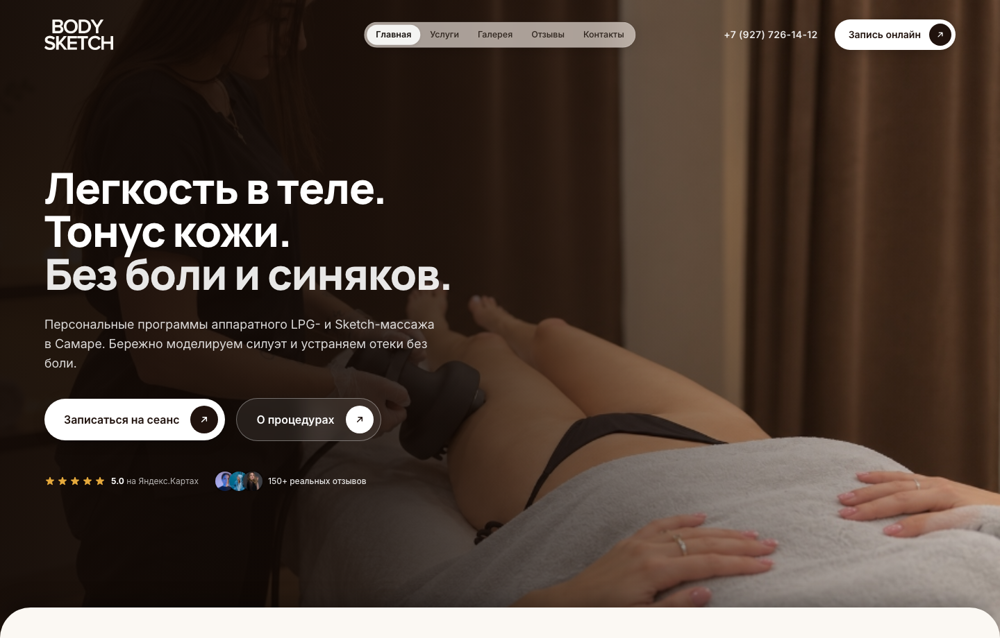

# BODY SKETCH — Студия массажа и эстетики тела

Премиальный лендинг для студии аппаратного массажа и эстетики тела **Body Sketch** (Самара, ул. Дачная, 26).



## О проекте
- **Бренд:** Body Sketch (Самара)
- **Стиль:** Премиальная эстетика Wellnest (глубокие теплые кофейные оттенки, природный шалфей, мягкое матовое стекло, адаптивная типографика Manrope & Inter)
- **Концепция:** Полноэкранный кинематографичный Hero-экран с панорамным фоном реальной студии, акцентными бейджами рейтинга (Яндекс.Карты 5.0) и быстрой онлайн-записью.

## Особенности реализации
- **Чистый HTML5 + Tailwind CSS + Vanilla JS** — быстрая загрузка без тяжелых фреймворков
- **Локальные ассеты** — шрифты (Manrope, Inter) и скрипты Tailwind закэшированы локально для автономной и быстрой работы
- **Компактная стеклянная навигация (Glassmorphism)** — навигационная капсула по центру шапки с плавным переключением активных пунктов
- **Полная адаптивность** — выверенная сетка для десктопов, планшетов и мобильных устройств (390px / 768px / 1440px / 1920px)

## Структура
```
├── index.html              # Главная страница
├── assets/
│   ├── styles.css          # Кастомные стили, анимации, стекломорфизм
│   ├── tailwind.js         # Tailwind runtime
│   ├── fonts/              # Локальные шрифты Manrope и Inter
│   └── *.jpg / *.png       # Фото студии и иконки
├── wellnest-desktop.png    # Скриншот десктопной версии
└── wellnest-mobile.png     # Скриншот мобильной версии
```

## Локальный запуск
Откройте `index.html` напрямую в браузере или запустите любой локальный HTTP-сервер:
```bash
python3 -m http.server 8000
```
Затем перейдите по адресу: [http://localhost:8000](http://localhost:8000)
